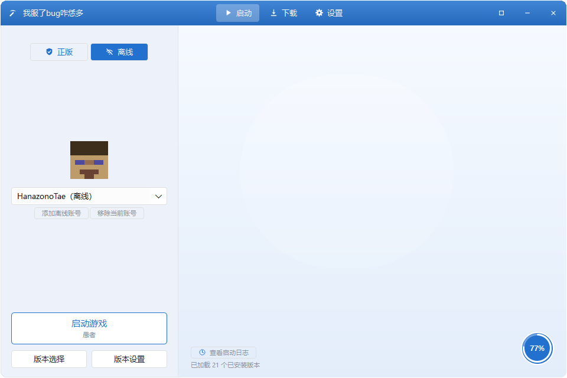
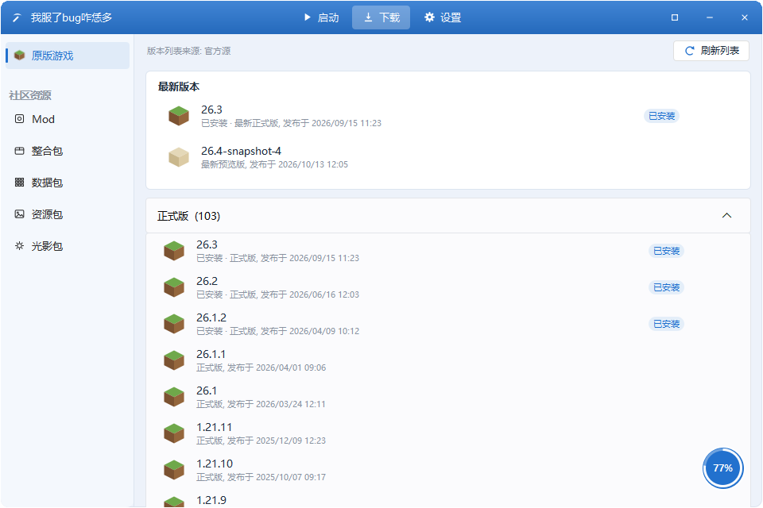
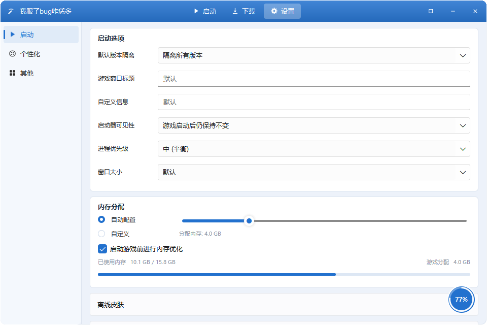
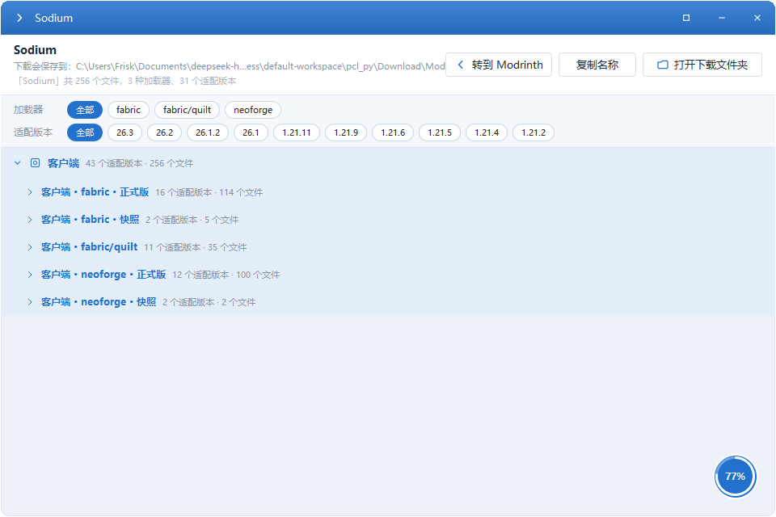

# CraftPilot · 基于 Python + PySide6 + QML 的 Minecraft 启动器

CraftPilot 是完全！由VibeCoding的产物。是一个用 **Python + PySide6 + QML** 编写的 Minecraft 启动器：界面参考 PCL2 逐页实现，
后端负责版本安装、整合包安装、社区资源检索与下载、启动与日志。

界面**全部用 QML 描述**（`qml/`），Python 只负责逻辑与数据：QML 由 Python 端的 `QQmlApplicationEngine`
加载，后端以 `context property` 注入，所以改界面只需要编辑 `.qml`，不用碰 Python。
窗口 **960×640** 起（可拉伸、可最大化），外壳为自绘标题栏 + 圆角，内容区组件来自内嵌的
PySide6-FluentUI-QML 套件。

| 启动（`shots/home.png`） | 下载 / 社区资源（`shots/download.png`） |
| --- | --- |
|  |  |

| 设置（`shots/settings.png`） | 资源详情（`shots/resource-detail-mod-sodium.png`） |
| --- | --- |
|  |  |

---

## 免责声明

> **本项目使用的大部分 API 与下载源为官方源或公开源，如有不符合使用协议的，仅为测试目的使用。**

具体涉及的第三方服务与端点（均来自代码，非推测）：

| 用途 | 端点 / 来源 | 代码位置 |
| --- | --- | --- |
| 游戏版本清单与版本 json | `https://piston-meta.mojang.com/mc/game/version_manifest_v2.json`、`http://piston-meta.mojang.com`、`https://launchermeta.mojang.com` | `pclpy/core/remote.py` |
| 原版资源文件（assets） | `https://resources.download.minecraft.net` | `pclpy/core/remote.py` |
| 官方库文件（libraries） | `https://libraries.minecraft.net`、`https://launcher.mojang.com` | `pclpy/core/install.py`、`pclpy/core/remote.py` |
| 镜像加速（BMCLAPI） | `https://bmclapi2.bangbang93.com/...`（版本清单 / assets / maven / forge 列表 / neoforge 列表 / optifine 列表） | `pclpy/core/remote.py` |
| Fabric / Quilt 元数据 | `https://meta.fabricmc.net`、`https://meta.quiltmc.org`、`https://maven.fabricmc.net/`、`https://maven.quiltmc.org/repository/release/` | `pclpy/core/remote.py`、`pclpy/core/install.py` |
| Forge / NeoForge 元数据与 maven | `https://maven.minecraftforge.net`、`https://maven.neoforged.net/releases` | `pclpy/core/remote.py`、`pclpy/core/install.py` |
| OptiFine 安装器与元数据 | `https://optifine.net/downloads`、`https://optifine.net/downloadx?...`、`https://bmclapi2.bangbang93.com/optifine/...` | `pclpy/core/remote.py`、`pclpy/core/install.py` |
| Maven Central（库回退） | `https://repo1.maven.org/maven2` | `pclpy/core/install.py` |
| 社区资源检索（Modrinth 官方 API） | `https://api.modrinth.com/v2`（`/search`、`/project/<id>/version`），`.mrpack` 索引也走这里 | `pclpy/core/remote.py` |
| CurseForge API（已定义端点，未接入） | `https://api.curseforge.com/v1` | `pclpy/core/remote.py`（运行时提示需要 API Key） |
| 社区资源页面外链 | `https://modrinth.com/` | `qml/pages/ResourceDetailPage.qml` |
| 内嵌组件套件 | PySide6-FluentUI-QML 1.6.7（`vendor/`，未改写其文件） | `vendor/PySide6_FluentUI_QML-1.6.7.dist-info/` |

补充两点，避免误解：

* 代码里出现的 `https://example.com/...`、`http://127.0.0.1:9/...`、`https://pclpy.invalid/...` 只存在于
  离线测试（`tests/test_core.py`）里，是**不会真正联网**的假地址，不代表任何第三方服务。
* 社区资源与整合包文件的**最终直链由 Modrinth API 返回**，因此运行时可能实际访问到
  `github.com`、`momot.rs` 等第三方主机；代码按 PCL2 的做法把 `bmclapi` / `github` / `optifine.net` /
  `momot.rs` / `pcl2-server` / `meloong` 列入**禁用多连接分片**的名单（`pclpy/core/remote.py:111`）。

这些接口大多是公开的或官方接口。
**请勿将本项目用于生产或商业用途；如fork修改时用到需要授权的服务方请自行与服务方获取授权。由本仓库衍生的项目与作者无关。**
本仓库不附带任何 API Key、账号凭据或授权凭据。

---

## 本项目的 CodeBase

* **语言 / 运行时**：Python **3.8+**（开发与验证环境为 Python 3.8.10）。
* **界面框架**：**PySide6 6.6.x**（开发与验证环境为 PySide6 6.6.3.1）+ **QML**（Qt Quick / Qt Quick Controls）。
* **界面组件套件**：**PySide6-FluentUI-QML 1.6.7**，已内嵌在 `vendor/FluentUI/`（含 `fluentuiplugin.dll`），
  **无需另行安装**；仓库未改写该套件的任何文件。窗口外壳（标题栏 / 圆角 / 导航）是自绘实现，不使用该套件。
* **没有自建后端服务**：全部逻辑跑在本进程内；`pclpy/core/` 是不依赖 Qt 的纯 Python 层，可单独导入与测试。
* **网络访问**：只用 Python 标准库 `urllib`，没有额外 HTTP 依赖。
* **依赖清单**：`requirements.txt` 只有一行 `PySide6>=6.6,<6.9`。

界面与行为参考 **PCL2**（Plain Craft Launcher 2，作者 **Hex-Dragon / 龙腾猫跃**，
`https://github.com/Hex-Dragon/PCL2`）；逐条对照分析（含 `文件:行号`）见 `PCL2_ANALYSIS.md`。

### 目录结构

```
pcl_py/
├─ main.py                入口（命令行参数 → 启动 → 收尾退出）
├─ run.bat                Windows 快捷启动（pythonw，无控制台黑框）
├─ requirements.txt       运行依赖（仅 PySide6）
├─ pclpy/                 后端（Python）
│  ├─ app.py              组装 QGuiApplication + QML 引擎 + 后端对象
│  ├─ theme.py            配色 / 字体 / 圆角半径 / 应用名（以 theme 注入 QML）
│  ├─ icons.py            图标现画（QPainter，不依赖图标文件）
│  ├─ avatar.py           像素风头像现画（不依赖皮肤文件）
│  ├─ providers.py        QML 图片提供者（image://avatar/... 等）
│  ├─ backend/            暴露给 QML 的 QObject / 列表模型 / 线程
│  │  ├─ launcher.py      账号、当前版本、启动游戏、任务系统、确认框
│  │  ├─ launcher_launch.py  启动流程与进程等待
│  │  ├─ launcher_tasks.py   任务系统公共部分
│  │  ├─ download.py      下载页（原版游戏）列表与安装、命名校验
│  │  ├─ resources.py     社区资源检索树与详情分组
│  │  ├─ settings.py      全局设置 + 版本独立设置
│  │  ├─ models.py        给 QML 用的字典列表模型
│  │  └─ workers.py       安装 / 导出 / 进程等待 / 日志跟进线程
│  ├─ core/               纯 Python 逻辑（不依赖 Qt，可单独测试）
│  │  ├─ paths.py         配置目录 / 缓存目录 / 游戏目录定位
│  │  ├─ config.py        配置读写（默认值、深合并、防抖落盘）
│  │  ├─ accounts.py      账号模型（离线 UUID 生成、序列化）
│  │  ├─ remote.py        版本清单、镜像、HTTP 与多连接分片下载
│  │  ├─ versions.py      已安装版本扫描与继承链解析
│  │  ├─ install.py       原版 / Fabric / Quilt / Forge / NeoForge 安装
│  │  ├─ launch.py        命令行组装、占位符替换、natives 解压
│  │  ├─ mods.py          Mod 列表与启停
│  │  ├─ resources.py     社区资源与 .mrpack 索引解析、下载编排
│  │  ├─ packexport.py    整合包导出
│  │  └─ catalog.py       内置可安装版本目录（`data/catalog.json`）
│  └─ data/catalog.json   内置版本目录数据
├─ qml/                   界面（全部 QML）
│  ├─ Main.qml            主窗口：标题栏 + 导航栈 + 对话框 / 文件选择 / 轻提示
│  ├─ components/         控件库（Pcl* 系列 + Card / SettingRow / Accordion / SideItem / …）
│  └─ pages/              页面（Home / Download / Settings / VersionSelect / VersionSettings /
│                         Task / Log / InstallVersion / LoaderVersion / ResourceDetail
│                         + settings/ + version/ 子目录）
├─ vendor/FluentUI/       内嵌的 PySide6-FluentUI-QML 套件（1.6.7，含 QML、字体、图标、DLL）
├─ tools/
│  ├─ shots.py            离屏截图（自动切页，含资源详情页）
│  └─ smoke.py            界面自检（运行期 QML 错误；`--anim` 另查切换动画）
├─ tests/test_core.py     核心逻辑离线测试（211 条，0 次真实网络请求）
├─ shots/                 界面截图（`python main.py --shot shots` 的产物；仓库内置 4 张主要界面图）
├─ PCL2_ANALYSIS.md       对 PCL2 源码的逐条对照分析（带 `文件:行号`）
├─ CHANGELOG.md           版本更新记录
├─ TODO.md                尚未实现 / 计划中的功能清单
└─ .gitignore
```

**QML ↔ Python 的接口**（在 `qml/` 里直接可用）：

| 名称 | 类型 | 作用 |
| --- | --- | --- |
| `theme` | QObject | 颜色、字号、圆角半径、应用名等设计变量（可通知） |
| `backend` | LauncherBackend | 账号、当前版本、启动游戏、任务系统、文件夹、确认框/提示 |
| `settings` | SettingsBackend | 全局设置读写（`value/setValue`）、内存、Java 检测、下载调参 |
| `versionSettings` | VersionSettingsBackend | 版本独立设置（含「跟随全局设置」语义） |
| `download` | DownloadBackend | 原版版本列表与安装、加载器列表、命名校验 |
| `community` | ResourcesBackend | 社区资源检索与详情（**注意：不叫 `resources`**，会和 QML `Item.resources` 撞名） |

---

**许多功能实际是空壳，未完成后端逻辑。**

下面这份清单是逐条从代码里对出来的，只列「界面上有入口、但点下去没有真实后端行为」的地方：

| 位置 | 现象 | 依据 |
| --- | --- | --- |
| 账号 → 「正版」 | 不弹登录流程，只弹一个说明框 | `pclpy/backend/launcher.py:537-543`（`loginMicrosoft` 只 `emit` 提示文案，无 OAuth / 设备码实现）；`pclpy/core/accounts.py:1` 自述「微软账号占位」 |
| 设置 → 启动 → 「离线皮肤」 | 能选模型、能选 png、能把路径写进配置，但**启动时不会生效**，界面也不显示所选皮肤 | 只有 `settings.setValue("skin.model"/"skin.path")`（`qml/Main.qml:571-572`、`qml/pages/settings/LaunchSettings.qml:255-305`）；`pclpy/avatar.py` 明确「不需要皮肤文件」，`pclpy/core/launch.py` 不读这两个键 |
| 设置 → 其他 | 原模板里的「社区资源」设置分组未实现 | `qml/pages/settings/OtherSettings.qml:7` |
| 版本设置 → Mod 管理 → 「下载 Mod」 | 只弹提示，指向社区资源功能 | `pclpy/backend/launcher.py:926-932` |
| 安装 → 版本列表里的 Forge / NeoForge 条目 | 自动安装未实现，提示改用手动安装 | `pclpy/backend/launcher.py:1030-1038`；`qml/pages/VersionSelectPage.qml:304` |
| 安装 → 版本列表里的整合包条目 | 自动下载整合包未实现，提示改用本地导入 | `pclpy/backend/launcher.py:1039-1043` |
| 社区资源搜索 | 只走 Modrinth；选 CurseForge 直接返回错误文案 | `pclpy/core/resources.py:34-38` |
| 版本设置 → 导出 → 「导出启动脚本」 | 版本未安装到磁盘时只给提示；导出本身在已安装版本上可用 | `pclpy/backend/launcher.py:816` |
| 关于 → 在线更新检查 | 固定文案「已是最新版本（在线更新未实现，仅提示）」 | `qml/Main.qml:832` |
| 其它 | 微软登录需自行申请 Azure 应用；`.mrpack` 中 CurseForge 托管的文件无下载地址，需 CurseForge API Key | `pclpy/backend/launcher.py:541`、`pclpy/core/resources.py:719-739,956-957` |

补充说明：

* `pclpy/` 的 Python 源码里独立成行的 `pass` 共 **92** 处（`qml/` 里没有）。它们绝大多数是**有意吞掉清理与收尾时
  的非致命异常**（例如删临时文件失败、线程已退出），不是空壳实现；上面表格里逐条给出的是真正没有后端逻辑的入口。
* 源码里没有 `TODO` / `FIXME` 标记（对 `pclpy/`、`qml/`、`tools/`、`tests/`、`main.py` 全量搜索，命中 0 处）；
  未做的事都以运行时提示文案或上表的形式记在这里。
* 核心逻辑层（`pclpy/core/`）有 211 条离线测试用例覆盖（见「运行方式 → 源码运行」），
  但这**只说明被覆盖到的路径能跑通，不代表功能完整**。

---

## 运行方式

### 方式一：源码运行

依赖：**Python 3.8+**、**PySide6 6.6.x**（验证环境：Python 3.8.10 + PySide6 6.6.3.1）。

```bash
pip install -r requirements.txt       # 只需要 PySide6
python main.py                        # 启动启动器
```

Windows 下也可直接双击 `run.bat`（用 `pythonw.exe` 启动，不弹 cmd 黑框）。

命令行参数：

| 参数 | 说明 |
| --- | --- |
| `--home <目录>` | 指定启动器配置目录（默认 `~/.pclpy`，也可用环境变量 `PCLPY_HOME`）；配置目录不存在时自动创建。 |
| `--shot <目录>` | 把各界面离屏渲染成 PNG 后退出（输出 14 张，含两张资源详情页）。 |

### 方式二：已打包的 exe（免安装绿色版）

工作区根目录（**仓库之外**）的已打包产物是 **`craftpilot_20261015_exe\`**（即 **`craftpilot_20261015.zip`**
解压后的结果：`CraftPilot.exe` + 同级 `_internal\`）。双击其中的 `CraftPilot.exe` 即可运行，
不需要装 Python 或其它运行库。

> 这是**开发构建**，可能**不包含**当前源码的最新改动；请以源码运行为准。
> 必须**整目录解压**：不要把 `CraftPilot.exe` 单独拖出来用，也不要直接在压缩包里双击
> —— 两者都会因为找不到同级的 `_internal\` 而无法启动。请保留随附的控制台窗口，它同时是日志输出窗口。
>
> 构建环境：Windows 10 19045 / Python 3.8.10 / PySide6 6.6.3.1 / PyInstaller 6.11.1。

---

## 功能概览

1. **版本管理 / 安装**：原版（正式版 / 预览版 / 远古版 / 愚人节版）在线清单，可切镜像源；
   加载器支持 **Fabric / Quilt / Forge / NeoForge / OptiFine**（单次安装仅支持单类加载器、四级页面选版本、
   安装前命名校验与自动避让）；版本选择页支持文件夹切换、分类分组、双击启动、右键或齿轮进版本设置、删除。
2. **整合包安装（`.mrpack`）**：可从社区资源搜索安装，也可选本地文件导入；按索引下载全部文件、
   解压 overrides、写入继承对应加载器的版本 json；缺少的原版与加载器会自动装好；本地已有的同哈希文件直接复用。
   实例完全独立（自带 jar + 合并 json，删掉父版本仍可用）。
3. **版本隔离**：判定顺序为 **单版本 `versions/<id>/PCL/Setup.ini` 标记 > 旧版 json 标记 >
   目录里已有 `mods`/`saves` > 全局设置 > PCL2 全局档位 > 加载器兜底**；首次运行把档位写死，
   两个启动器互认同一份标记。
4. **社区资源**：Mod / 整合包 / 数据包 / 资源包 / 光影包检索（Modrinth API），资源详情页按
   **加载器 → 适配版本 → 文件**两级分组、两组都可折叠；数据包区分**客户端 / 服务端**两大类与核心分区；
   下载目录固定在 `<启动器目录>/Download/<类型>`。
5. **下载引擎**：多连接 Range 分片、自适应加段（带冷却与总次数上限）、**sha1 校验**（拼接前后都校验）、
   本地同哈希复用、失败文件标记未完成并可重试、断点原地续传、源级禁用与全源降级单线程重试、取消不留残留；
   参数（分片开关 / 段数 / 并发 / 阈值 / 限速 / SSL 校验）可在设置里调。
6. **设置**：启动（内存 / Java / JVM 与游戏参数 / 窗口大小 / 离线皮肤）、个性化（主题色、悬浮按钮）、
   其他（下载源、线程数、限速、SSL 校验、游戏语言、导入导出设置）。环境变量优先级高于界面设置。
7. **启动与日志**：按版本 json（含 `inheritsFrom` 链式合并）组装命令行、解压 natives、去重库、
   补 Forge/NeoForge 的模块参数；游戏输出写 `versions/<版本id>/pclpy_launch.log` 并实时显示到「启动日志」页。
8. **任务系统**：下载 / 安装 / 导出统一走「任务管理」页与右下角悬浮圆标（总进度、速度、剩余文件、
   分步进度、取消）；多任务可并行。
9. **UI**：PCL2 风格外壳（自绘标题栏、圆角窗口、一级淡入上浮 / 二三级横向滑动）+
   内容区使用 PySide6-FluentUI-QML 组件（`PclButton` / `PclCheckBox` / `PclTextField` / `PclComboBox` /
   `PclSlider` 等）；14 个界面可用 `--shot` 一次性离屏渲染出来逐页核对。
10. **已知限制**：微软正版登录未内置；Forge / NeoForge / 整合包条目的自动安装未实现；
    CurseForge 来源需要官方 API Key；整合包格式目前支持 `.mrpack`（以及内含 `modrinth.index.json` 的 zip），
    其它启动器的包格式未支持；离线皮肤未接后端（详见上一节）。

---

## 引用与参考

**上游项目与第三方**

* **PCL2 启动器**（Plain Craft Launcher 2，作者 **Hex-Dragon / 龙腾猫跃**）：仓库
  `https://github.com/Hex-Dragon/PCL2`。本项目的界面与行为大量参考 PCL2。
  > 取证时该克隆的 remote 为`https://github.com/Meloong-Git/PCL.git`（HEAD `f8584954`，2026-10-13），
  > 而 `Hex-Dragon/PCL2` 会重定向到同一个仓库 —— 两者是同一份源码的两个地址。
  > 对照结论（每条带 `文件:行号`，如 `ModNet.vb:857-862`、`ModMinecraft.vb:227-266`）见
  > **`PCL2_ANALYSIS.md`**。
* **PySide6-FluentUI-QML 1.6.7**：内容区控件套件，来源仓库 `https://github.com/zhuzichu520/FluentUI`
  （版本号取自 `vendor/PySide6_FluentUI_QML-1.6.7.dist-info/METADATA`；LICENSE 在该 dist-info 内，
  本仓库未改写其任何文件）。外壳不使用它，外壳是自绘实现。
* **Modrinth 官方 API**：`https://api.modrinth.com/v2`（代码里的 `endpoint("modrinth")`），
  用于社区资源检索（`/search`）与项目版本/文件列表（`/project/<id>/version`），也是 `.mrpack` 索引的来源。
* 其它数据源：Mojang 官方版本清单与资源站、BMCLAPI 等镜像（用于加速；`bmclapi` / `github` /
  `optifine.net` 等按 PCL2 的做法禁用多连接分片）。完整清单见上文「免责声明与授权说明」。

**本项目自身文档**

* `PCL2_ANALYSIS.md` —— 对 PCL2 源码的逐条对照分析（含差异、风险警告、建议优先级）。
* `TODO.md` —— 尚未实现 / 计划中的功能清单。
* `CHANGELOG.md` —— 版本更新记录。
* `shots/*.png` —— 界面截图（仓库内置 4 张主要界面图），可在不启动程序的情况下核对界面。

> 以上文档都在本仓库内；除已列出的上游地址外，本文**不引用**任何未在此列出的链接或许可证。
> 仓库内**没有** LICENSE 文件：本项目目前未附授权条款，转载与二次分发前请先与作者确认。

---

**版本更新记录见 [`CHANGELOG.md`](CHANGELOG.md)｜尚未实现的功能清单见 [`TODO.md`](TODO.md)｜PCL2 对照分析见 [`PCL2_ANALYSIS.md`](PCL2_ANALYSIS.md)**
